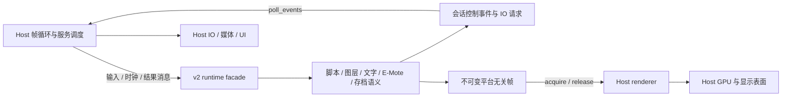

# Artemis Host ABI v2：接口契约（草案）

日期：2026-11-17。状态：C ABI 和完整服务 schema 尚未发布，当前动态库继续使用 v1。
现状证据见 [EXPORT_AUDIT.md](EXPORT_AUDIT.md)，C 接口骨架见
[abi/art3m1s_core_v2.draft.h](abi/art3m1s_core_v2.draft.h)。

## 1. 范围与设计决策

只重构 Artemis/Art3m1s 的公开接口及其内部 Host 边界。RFVP、KRKR、Siglus 保持现有
独立 ABI、构建和适配，不纳入统一 runtime，不修改它们的上游补丁。共同依赖 crate 的
破坏性调整必须另行评估；本方案不能用一次共享接口替换迫使其他引擎一起迁移。

**core 生成渲染数据，Host 绘制并呈现**。core 保留引擎语义
与 CPU 侧计算，Host 执行物理 IO、GPU 绘制、音视频解码/输出和最终呈现。Host 拥有
renderer，core 不保留原生 GPU 合成与 present 的生产路径；现有 renderer 以 Host SDK 复用。

其余建议决策：

1. 新增独立 v2，冻结 v1 布局、返回值和 feature 语义；禁止原地把 v1 指针参数改成整数。
2. 一个动态查询符号、小型 runtime 表、独立 frame 表，能力与消息 schema 分开版本化。
3. 继续使用 Host 调 core、core 排队、Host 拉取；不恢复 native→Dart 或其他语言反向回调。
4. 所有游戏状态、输出和请求按 runtime 隔离；会话重载增加 epoch。
5. 统一 status、代际句柄、明确所有权；不公开 Rust 容器、trait、DrawList 内存布局或平台指针。
6. 先完成 IO continuation 与帧契约验证，再冻结 v2 的消息编号、capability 位和绑定。

发布的 ABI 必须定义完整的消息 kind、能力位、渲染 opcode 和资源格式，并提供对应的
Host 一致性验证。目前头文件中的这些协议部分仍待实现，尚未冻结编号。

## 2. 职责边界

| Core | Host / 可复用的 Host SDK |
|---|---|
| ASB/AST/IET/Lua 语义、变量、流程、事件顺序 | 窗口、系统生命周期、输入设备、坐标转换、线程调度 |
| 图层树、布局、命中测试、动画、转场语义 | GPU device/context、纹理上传、命令执行、同步、surface 和 present |
| 文本/Ruby 排版、字形 CPU 数据、E-Mote 求值和网格 | 系统字体发现，提交字体字节，选择 renderer 的质量/升频策略 |
| 资源逻辑路径、缓存版本、必要的纯字节解析/解码 | 目录/PFS/其他归档、分卷优先级、覆盖层、网络缓存、沙箱 |
| 存档格式、快照/恢复、脚本存档钩子 | 读写删除、原子落盘、持久化确认、物理存档目录 |
| 音视频逻辑状态、等待/完成处理器、播放实例标识 | 解码、混音、设备、音频时钟、视频表面/全屏展示 |
| 服务请求和回填规则 | HTTP、对话框、剪贴板、浏览器、翻译、native call 等 |
| 消费 Host 注入的逻辑/日历时间和随机种子 | 时钟来源、后台时间策略、时区和随机种子生成 |

Core 可对 Host 提交的字节做 PNG、字体、PSB 等平台无关计算；“IO 由 Host 实现”
不要求 Host 重写这些格式解析。Core 不读取磁盘路径，不加载图形驱动，不调用系统设备，
不偷偷创建临时文件、线程式媒体提取或窗口。所有平台对象止于 Host adapter。

可复用 renderer 继续使用当前 `art3m1s-render` 的算法与后端。为保护其他引擎，第一步
是新增 Artemis Host adapter/契约桥，而非重写其共享 `GpuBackend` 或删除内置 E-Mote。

## 3. 对外 API 形态

建议唯一新查询入口为 `art3m1s_get_api_v2`，无需 GPU feature 即可存在。旧 v1 查询入口
仅在 legacy 构建中保持，不能把它静默改指向 v2。v2 根表不装载其他引擎。

| 表 | 字段 | 用途 |
|---|---|---|
| Root | `query_interface` | 按 interface ID、major 和最小前缀大小获取表 |
| Root | `copy_last_error` | 即使 create/query 失败也可读取当前线程 UTF-8 错误 |
| Runtime（必选） | `create` / `destroy` | 纯逻辑 runtime；分配/回收代际句柄 |
| Runtime | `open_project` | 提交原始 INI 字节、INI 分节、可选 reported OS，开始 Loading |
| Runtime | `step` | 推进一次 Host frame，恢复可执行 continuation，生成事件和最新帧 |
| Runtime | `submit` | 批量提交输入、Host 状态、配置及带身份的服务结果 |
| Runtime | `poll_events` | 批量读取完整可靠事件和可丢诊断记录 |
| Runtime | `get_state` | 获取会话、舞台尺寸、等待、退出、积压和丢弃计数 |
| Frame（按能力查询） | `acquire_latest` / `release` | 获取/释放不可变渲染快照，无平台对象 |

初始合计 11 个函数指针，分布在三张表。这个数字不作为重构成功标准；消息 schema 仍是
公开 API 的一部分。禁止用任意字符串 `invoke(method, json)` 把不受约束的私有 RPC 塞进
`submit`；每个 domain/kind 都必须有版本、字段、失败分支和一致性测试。

标题探测使用 headless/probe runtime 和相同 IO 协议，在第一条 caption 或预算耗尽时结束，
不创建 renderer。完整游戏的最低 Host 组合是 runtime + IO + renderer + media 完成协议；
不支持 UI/网络等可选服务时按已定义失败分支恢复。

### ABI 演进与类型

- 表头为 magic、struct_size、interface_id、abi_major、abi_minor；同 major 只允许尾部追加。
  Host 校验 major 和所使用的最小前缀，不能要求未来表与自己精确等长。
- C ABI 使用目标平台原生指针和 C 对齐，不使用 packed struct。32/64 位绑定分别生成并核对
  sizeof/offsetof。API 表是本进程 ABI，不是网络格式。
- 状态/枚举固定 `int32_t`/`uint32_t`，句柄/ID/长度用 `uint64_t`；长度转为本机索引前
  检查 `SIZE_MAX` 和各自预算，乘法检查溢出。布尔为明确定义的整数。
- 字符串统一 UTF-8 指针+字节数，无终止 NUL；原始 INI/脚本字节保留其引擎编码。
  长度非零时指针不可空，长度为零时可空。浮点参数必须有限并按字段约束验证。
- 结构均带 struct_size，保留字段写零；未知可选尾字段忽略，未知必选 feature/schema 拒绝。
  表内 required 字段不可空；缺少整个可选接口时 query 返回 UNSUPPORTED。
- 所有输入和输出结构的 struct_size 由 Host 在调用前设置；core 只读写协商前缀内的字段。
  失败时将普通 out 值清零，不改 Host 的 struct_size；BUFFER 的所需容量是明确例外。
- 只承诺 C calling convention。Rust 使用独立 `api` facade，不能把 trait/vtable 或
  `Vec`/`String`/`HashMap` 直接交给 C 或按其布局序列化。

### 返回值

所有函数返回同一 `ArtStatus`：0=OK，1=NO_DATA，2=WOULD_BLOCK，负数为错误。
数据和写入数量走 out 参数，禁止“负容量”“字节数既是成功又是错误”等混用。
错误至少区分 ARGUMENT、HANDLE、THREAD、UNSUPPORTED、BUFFER、STATE、STALE、LIMIT、PANIC。

BUFFER 返回所需大小且不消费队首记录。NO_DATA 表示没有新数据。WOULD_BLOCK 表示本次
操作未被接受，可在排空队列、消费结果、完成请求或释放 lease 后重试，不表示应重复推进同一 frame。
异步服务失败（not_found/denied/io_error/cancelled 等）走对应结果消息，不冒充 ABI 调用失败。
poll 若至少写出一条完整记录则返回 OK，并在 out 标出下一条所需空间；仅首条装不下时
返回 BUFFER。输出参数清零不得造成已交付记录被隐藏；NO_DATA/BUFFER 都不移除未交付记录。

错误文本线程局部，`copy_last_error` 不覆盖被读取的错误；失败的 create/query 也能报告。
成功调用不要求清空旧文本，只有错误 status 才说明该文本属于本次调用。
可捕获的 panic 统一转为 PANIC 并使相关 runtime Faulted，避免在半完成状态继续推进；
这不承诺恢复 OOM、abort 或非法调用者内存。

## 4. 会话、线程和生命周期

运行时状态为 Created → Loading → Running → Closing → Closed；不可恢复错误进入 Faulted。
IO/UI 等等待另用 wait_flags/pending_requests 表示，不把全局状态改为“整个引擎暂停”。
Loading 完成必须有事件和状态转换；`open_project` 返回 OK 只表示已受理。

- 句柄 0 无效，registry 记录对象类型、代际和 owner thread。跨类型、陈旧或重复 destroy
  返回 HANDLE；错误线程返回 THREAD。不同 runtime 不能因独立表碰巧编码相同而互认。
- create/open/submit/step/poll/state/frame/destroy 统一在创建它的 owner 线程执行。
  GUI、IO、媒体线程把结果投递给 Host 自己的 owner 队列；C ABI 不接受跨线程直调。
- 每次成功受理 open/reload 增加 session_epoch，取消旧请求并丢弃旧会话未交付控制事件。
  首先交付新 epoch 的 session_changed，Host 据此取消旧 IO/UI/媒体任务并停止呈现旧帧。
  已借出的旧帧字节继续有效到 release；尚有 lease 时允许 reload，但 destroy 返回 STATE。
- `request_id` 在同一 runtime 生命周期内单调分配且不重用；计数耗尽返回 LIMIT。
  结果按 `(runtime, epoch, request_id, service kind)` 校验；重复/过期结果返回 STALE，无副作用。
- 收到退出请求后 Host 提交 graceful shutdown。core 发出必要的最终存档/媒体停止请求；
  Host 执行并回填，直至 Closed 后 destroy。Faulted 可强制销毁，仍须先释放所有帧。
  强制退出可以放弃未确认存档，不能把它记录为成功持久化。
- Rust 运行时的 `submit_shutdown(handle, epoch)` 在 Running 阶段受理。游戏暂停在退出点；
  尚有服务结果待处理时先完成它并推进 `step`。受理后状态进入 Closing，不再运行场景，按顺序
  确认全局数据、系统设置和已变化的已读记录。`runtime_closed` 排入队列后才进入 Closed，期间
  拒绝重载。Host 在销毁前拉取关闭结果。
- 所有 debug、字体、窗口状态、文本表、surface/资源 CPU 缓存和诊断计数归 runtime。
  进程级库初始化日志单独交给 SDK 诊断，不能偷偷路由到最近运行的游戏。

`step` 接收 Host 的 frame ID、单调时间、UTC 时间及时区，首次只锚定单调时钟。
相同 frame ID、相同单调时间可用于 IO 回填后继续本帧，不能再次消费输入边沿、触发
onEnterFrame 或累计动画 delta；更小 ID/时间返回 ARGUMENT。后一 Host frame 的时间差
只累计一次。后台冻结通过 Host 明确的 pause/resume 策略处理，不任意截断 E-Mote 时间。
日历 API 可使用更新的 UTC，逻辑时间不得由日历时钟倒退影响；诊断计时与游戏时钟分离。
日历时区使用 Host 提交的 UTC 分钟偏移（-1440..1440），core 不读取本机时区。
e:now、os.clock 和等待截止时间使用逻辑单调时间；os.time/date、date/unixtime 变量
及文件修改时间格式使用日历快照，os.date 的 `!` 前缀使用 UTC。
随机状态由每个 VM 持有，Host 可提供种子；变量快照恢复不替换当前环境服务。

当前 Rust 场景驱动按帧 ID 串行运行逻辑：若前一帧仍有 IO continuation，新帧返回
WOULD_BLOCK 且不受理。Host 先回填并恢复原帧，再提交新帧；结果提交本身不执行回调。
帧 ID 只在同一会话 epoch 之内比较。定时等待从场景到达等待的那一帧开始计时，最早从下一帧
按单调时间解除；UTC 变化和同帧重入不影响期限。输入、跳过对定时等待的影响随输入调度接入。
媒体和渲染调度仍待接入。

## 5. 消息、可靠性与能力协商

`submit` 原子受理一个批次并复制其 metadata/blob；返回后 Host 可释放输入。语义校验、
容量和身份检查失败时整批不受理。受理不直接运行 Lua；只在 `step` 的确定性边界执行。
输入、状态和结果在批内按顺序处理。初始建议上限为每批 4096 条、单条 blob 1 MiB，
大文件必须分块，最终限制作为可查询能力冻结。

`poll_events` 按以下固定小端格式写入完整记录，不直接 memcpy C struct：

| 偏移 | 类型 | 字段 |
|---|---|---|
| 0 | u32 | record_bytes，含头和 body |
| 4 | u16 | envelope_version，初值 2 |
| 6 | u16 | domain |
| 8 | u32 | kind，domain 内稳定编号 |
| 12 | u32 | flags：0x1 requires_reply，0x2 critical，0x100 JSON/blob body |
| 16 | u64 | runtime_handle |
| 24 | u64 | session_epoch |
| 32 | u64 | sequence，runtime 生命周期单调递增 |
| 40 | u64 | request_id；无回应通知为 0 |
| 48 | u32 | body_bytes |
| 52 | u32 | reserved=0 |

头长 56，`record_bytes = 56 + body_bytes`。控制记录 body 是小端
`metadata_bytes:u32, blob_bytes:u32, UTF-8 JSON metadata, raw blob`，两段长度相加加 8
必须等于 body_bytes；metadata 必须为 JSON object，无 NUL/隐含 padding。诊断使用相同 body。
Runtime domain=1、kind=1 为 `session_changed`，request_id=0，metadata=`{}`，blob 为空。
Runtime kind=2 为 `project_ready`，字段同上；BOOT 与加载期 Lua 完成后交付。记录排入
可靠队列时状态由 Loading 转为 Running，且排在首条场景输出之前。
Runtime kind=3 为 `exit_requested`，字段同 `session_changed`。
Runtime kind=4 为 `runtime_closed`，request_id=0、blob 为空；metadata 为
`{"save_status":"written"}` 或 `{"save_status":"failed","reason":"…","files_written":1}`。
`files_written` 是本次关闭期间已经收到持久化确认的文件数。
Runtime kind=5 为 `persistence_result`，request_id=0、blob 为空。`operation` 为 `save`
或 `load`；`status` 为 `written`、`restored` 或 `failed`。失败包含 `reason`；保存失败
还包含 `files_written`，表示此前已确认的文件数。结果先进入可靠队列，再继续场景。
服务请求只使用 IO/UI/media/render domain；其余 service kind 和 payload 由各自 schema 定义。
高频 input/render 可以使用独立版本化二进制
body，由 flags/kind 唯一标识。JSON 中的 u64/i64 使用十进制字符串，避免宿主 Number 精度丢失。
禁止把图片/存档/HTTP body 转成 JSON 数组或 base64 作为常规传输。

UI domain=4 当前实现两个草案 kind，blob 均为空：

| kind | 请求或通知 | 结果 |
|---|---|---|
| 1 `ui.caption` | 可靠通知，`{"text":"…"}` | 无回复 |
| 2 `ui.dialog` | 请求，`title`、`message` 为字符串，`allow_cancel` 为布尔值，`initial_text` 为字符串或 null，`max_characters` 为十进制字符串或 null | `{"status":"ok","accepted":true,"text":"…"}`；`text` 可省略。`cancelled`、`denied`、`unsupported`、`io_error` 按取消完成 |

`initial_text=null` 表示无输入框。Core 在 `step` 应用结果，接受时按约定字符上限写入
输入变量，取消时保留旧输入内容。Host 重载时按 `session_changed` 取消旧对话框。

控制队列与诊断队列各有条数和总字节预算。初始建议为控制 4096 条/16 MiB、诊断
1024 条/1 MiB；实际配置和上限需可查询。请求和媒体控制消息可靠，日志可丢并计数。
满载时必须在产生副作用前预留控制记录，或挂起尚未提交的内部操作；不能先推进脚本再
丢请求。即便游戏等待 Host，也要允许 poll 和结果回填；关键请求不能被日志阻塞。

控制记录按 FIFO 优先交付，排空后才交付诊断；跨队列不承诺 sequence 递增。
诊断满载或超过单条预算时丢弃新记录，
累计丢弃次数；其容量不占用控制预算。重载清除两个队列与旧结果，保留生命周期丢弃计数。
已受理结果另有默认 4096 条/16 MiB 预算，等待请求默认上限为 4096。metadata 和 blob
各默认限 1 MiB。字节预算按信封、长度头、metadata 和 blob 的编码总长计算。
单条或整批超过空队列总预算返回 LIMIT；仅因现有积压而放不下时返回 WOULD_BLOCK。

只有已被 poll 交付的请求可以接收结果，提前提交返回 STATE。结果批次的重复身份、
错误 runtime/epoch/service kind、已受理/取消的请求均返回 STALE，并保留整批原状态。
结果受理后从等待请求中移除，按提交顺序进入结果队列；等待计数与已受理结果计数分别查询。
消费结果后释放其容量。取消尚未交付的请求同时移除该控制记录；已派发的外部任务需要
服务层另发取消通知。本地取消不代表 Host 已停止外部工作。

可靠控制按 sequence 交付，诊断可分批穿插；Host 不得等待 sequence 连续，因为日志
允许丢失。新帧可以合并，但影响转场或存档的资源版本不能随着“丢中间帧”丢掉。
未知可选通知可忽略；未知 requires_reply 请求必须回应 unsupported，并有可记录的终止路径。

能力分成两侧：Host 声明 IO/UI/media/renderer 能力；core 报告支持的协议版本和引擎特性。
缺少可选服务按规范失败完成；缺少游戏启动所需的 IO/渲染能力时明确拒绝启动。
不用 nullable 函数槽猜测所有服务能力，也不静默自动选择另一个 GPU backend。

## 6. IO：Host 实现、core 保留语义

所有 IO 通过请求与结果消息完成；core 的 VFS/cache 只保存逻辑资源和字节，不保存
`PathBuf`、File 或本机存档根。Host 可调用独立 PFS SDK、内存包、原生文件系统或远程服务。

| 操作 | 请求 | 完成及约束 |
|---|---|---|
| `io.stat` | namespace、key | found、size、revision、可选 UTC mtime；空文件与不存在有区别 |
| `io.read` | namespace、key、revision、offset、length | 原始 blob、实际长度、EOF；跨 revision 拒绝或明确重试 |
| `io.list` | namespace、prefix、cursor | 一页逻辑条目、revision、下一 cursor；目录枚举不暴露物理路径 |
| `io.write_atomic` | save key、transaction ID、分块描述和 blob | Host 接受全部数据并原子提交后确认；受理不等于落盘 |
| `io.delete` | save key | 明确 deleted/not_found/denied/io_error |
| `io.cancel` | 原 request ID | 取消尽力而为；之后到达的旧完成消息仍按 STALE 处理 |

### stat、read、单 blob 原子写入与 delete payload

这些控制消息均使用 JSON object metadata，二进制数据只放 blob。IO domain=3，
stat/read/write_atomic/delete 的 kind 分别为 1/2/4/5。结果使用原请求的 service kind；
request ID、epoch 和 runtime 均由信封/提交描述符携带。

| 消息 | metadata | blob |
|---|---|---|
| stat 请求 | `namespace: "asset"/"save"`，`key: string` | 空 |
| stat 成功 | `status: "ok"`，`found: bool`；found=true 时还需 `size`、`revision`，可选 `modified_utc_ms` | 空 |
| read 请求 | namespace、key、revision、offset、length | 空 |
| read 成功 | `status: "ok"`、revision、`eof: bool` | 读取的原始字节 |
| write_atomic 请求 | `namespace: "save"`、key | 整个待提交文件 |
| write_atomic 成功 | `status: "ok"` | 空 |
| delete 请求 | `namespace: "save"`、key | 空 |
| delete 成功 | `status: "ok"`（Host 已确认删除） | 空 |
| 任何失败 | status 为 `not_found`/`denied`/`io_error`/`cancelled`/`unsupported`，可选 `message: string` | 空 |

size、revision、offset、length 均为规范十进制 u64 字符串，不使用 JSON number。
modified_utc_ms 为规范十进制 i64 字符串，表示 UTC Unix 毫秒；缺失或 null 表示无时间元数据。
读取须保持 stat 返回的 revision，单次不超过 length；短读允许，但非 EOF 必须有数据，
累计数据必须与 stat 大小一致，准确到达文件末尾时 eof=true。revision/EOF/大小不一致的
结果返回 ARGUMENT，原请求仍等待 Host 修正。Host 发现资源变化时可返回 io_error，让
脚本进入原有失败分支。空文件在 stat 后即可完成读取。

单 blob 写入以 `(runtime, epoch, request_id)` 作为事务身份；Host 原子持久化后确认。
超出 blob 预算时不受理；多 blob 事务需要另行定义分块/提交 schema，不能将部分成功表示为
文件写入完成。删除只适用于 save 文件，目标不存在返回 not_found；完成前脚本不能继续。
完整服务能力由 facade 协商。

namespace 至少区分 asset 与 save；逻辑 key 使用 `/`，拒绝绝对路径、驱动器、NUL 和 `..`。
Artemis 的大小写兼容查找、归档覆盖顺序、别名和 savepath 需要独立 conformance 样例；
不能直接照 OS 大小写规则查找，也不能因重构改变已有 patch/sidecar 优先级。
脚本 savepath 是逻辑子目录，实际游戏隔离根由 Host 决定，禁止两侧重复拼接前缀。

Host 可预提交完整资源元数据索引以同步回答 exists/stat；未缓存的结果表示 Pending，
不表示不存在。热路径使用 CPU 缓存；大文件分块，所有块都校验资源 revision。
写入成功后才更新可见版本；缓存的 save 内容与宿主存储版本必须保持 read-your-writes。
Host 的 unsupported/permission/error 必须能进入脚本原有失败分支，不允许无限等待。

Artemis Rust 入口在图层首次引用 PNG 或蒙版时，用 IO 读取逻辑资源并在内存解码。资产与
尺寸按当前会话复用。缺失或不可解码的图片仍保留逻辑图层；未指定尺寸时查询返回零。

编号存档可包含场景树和保存时的缓动进度。读档先校验场景树并通过相同 IO 预读所需图片，
然后提交恢复；取消预读不替换场景。原已借用的帧仍有效。仅含解释器状态的旧快照可读，
文字和音频快照尚未接入句柄入口。

**同步 Lua 是必须先解决的实现门槛：**当前同步 EngineCallbacks 需要改成可保留调用现场的
资源依赖/continuation，或在进入该调用前完整准备它所需数据。索引预载只能解决已知查询，
还需覆盖任意动态文件名、写入确认和 Lua 中间加载。统一 Luau 后必须验证能从
原位置恢复且不重复前面的副作用。若任一生产路径不能安全挂起，先保留 v1，不发布不完整 v2；
也不偷偷恢复磁盘回退、阻塞 GUI 的桥接或反向回调。

最小语义用例：Lua 先将计数加 1，再读取尚未加载的动态资源，恢复后仍只加 1；写存档
失败进入失败分支；IO 等待时 onEnterFrame/音频等待和输入边沿仍遵守原引擎行为。

## 7. 画面：core 帧契约与 Host renderer

core 输出 `FramePacket`，Host 管理 GPU、编译执行 shader、上传、同步和呈现。现有
`DrawList` 是 Rust 实现契约，不能直接作为跨语言 ABI。先做可复用 Host renderer SDK，
其他 Host 可以使用 SDK，也可以实现同一渲染协议。

帧契约至少必须覆盖：

- 舞台大小、逻辑 frame ID、资源 revision、dirty/damage，坐标原点左上、x 右/y 下；
  Host 负责 viewport、DPI 和输入反向转换，不能修改脚本图层身份。
- sprite/mesh、UV、完整变换、颜色/透明度、混合和采样模式、clip、mask/stencil、
  shader group、render pass 依赖及临时 target，不能只导出矩形列表。
- 文本 glyph 数据、Ruby、E-Mote mesh/material/stencil 语义；图层 ID 以原始字符串保留，
  不把 `1.80` 转成浮点。CPU 命中测试所需 alpha/尺寸由 core CPU 资源层维护。
- 纹理逻辑 ID + revision + 像素/编码描述，不含 GL 名、Metal/Vulkan 指针、IOSurface
  或窗口句柄。Host 对象始终留在 renderer 内；核心最多引用协议里的 opaque resource ID。
- 明确颜色空间、alpha（每个资源的 straight/premultiplied 标志）、纹理原点、行跨度和格式；
  Host SDK 用回归像素证明与旧后端一致，不能在草案阶段随意统一而改变游戏画面。
- 转场旧帧捕获、滤镜/HLSL、lyedit、存档截图的准确时点与资源保活。捕获用逻辑 target
  和显式完成消息；core 不再自己调用 GPU readback，脚本等待依赖按 request ID 恢复。
- 视频图层绑定播放实例/resource revision，由 Host 解码并在 renderer 侧更新图像。
  全屏视频仍由 Host 管理；时间、结束和失败回报进入同一媒体协议。

FramePacket 必须采用有版本的二进制 schema，所有偏移以 packet 起点计算、做范围/溢出检查；
不能包含 Rust 内存地址。schema 完整定义、资源数据组织和 opcode 编号是 P0/P3 冻结项。
Host renderer 接入以完整帧 schema 和绘制回归为验收依据。

Rust 草案先提供 `acquire_latest(handle, after)`，可借用基础图层快照。`sprites` 按绘制顺序
给出纹理表索引、原始图层 ID、仿射变换、UV、舞台裁剪、颜色、透明度和混合方式。纹理是
紧密排列的 RGBA8，直通 alpha，首行在顶端；资源缓存键为 `(runtime, epoch, revision)`。
同尺寸蒙版用独立纹理索引表示：采样前逐像素以 `alpha * mask_red / 255` 取整得到新 alpha。
缺失或尺寸不符的蒙版回退为原图。此草案只覆盖图片和纯色图层；需 shader、mesh 或 stencil
的帧不从该入口交付。Rust 借用随 `FrameLease` 释放。

`FrameLease::packet()` 返回 `ARFP` 草案版 1 的二进制描述；`texture(index)` 借用对应像素。
C 草案的 `texture_rgba` 也使用帧内索引，像素和帧描述一起由同一个 token 保活。
帧描述最长 16 MiB；所有整数和 IEEE 754 `f32` 都用小端，无结构体填充。

| 区段 | 按顺序的字段 |
|---|---|
| 帧头，56 字节 | `"ARFP"` [4]；schema `u16`；头长 `u16`；总字节数、纹理数、绘制记录数、保留零各 `u32`；epoch、render frame ID、Host frame ID 各 `u64`；舞台宽、高各 `u32` |
| 纹理描述，每条 24 字节 | revision `u64`；宽、高、行字节数各 `u32`；像素格式 `u16`（1 = RGBA8，直通 alpha，首行在顶端）；保留零 `u16` |
| 精灵记录，104 字节前缀 | 记录总长度 `u32`；opcode `u16`（1 = 精灵）；flags `u16`；纹理索引、蒙版索引、混合方式、图层 ID 长度各 `u32`；变换 6 个 `f32`，矩形尺寸、UV 偏移、UV 缩放各 2 个 `f32`，裁剪 4 个 `f32`，opacity 1 个 `f32`，RGB 乘色 3 个 `f32` |
| 精灵记录尾部 | 按长度读取 UTF-8 图层 ID，含在该记录总长度内，无 NUL 与填充 |

索引从 0 开始；无蒙版用 `UINT32_MAX`。混合方式按 Alpha、Add、Screen、Multiply
依次编号 0 至 3。flags 的低三位依次表示裁剪、灰阶和反色，其余写零。裁剪为舞台上的
左、上、宽、高，未设置时四项均为零。变换顺序为两列基向量、平移。
Host 解析时应先校验版本、总长度、各段计数与记录边界，确认纹理索引和像素长度有效后再绘制。
C 帧接口仍为草案，未发布新的动态符号。

Rust Host 可使用 `host::renderer::SpriteRenderer` 在已开启的目标上绘制基础帧。适配器使用
同一帧借用的类型化视图，维护会话和资源版本对应的后端纹理。Host 控制 backend 的访问、
目标、帧开始与结束及呈现；新设备可以用仍有效的帧借用重新上传。

`acquire_latest(after_render_frame_id)` 返回不可变快照和 lease token；无新帧为 NO_DATA。
快照及所有引用的 CPU 资源版本在 release 前跨 step/reload 保持有效；默认至多两个
外借 lease，超过返回 WOULD_BLOCK。CPU 不可变块可以共享，不能每帧复制整个资源库。
Host 完成 CPU 读取/上传暂存后可 release，GPU 对象由 Host 按自身 fence 保活，不要求
core 理解原生 fence。纹理销毁由 Host 在 GPU 引用结束后执行。

逻辑 tick 与出帧独立：Host 每个 frame 调一次 step，无新画面时继续执行 onEnterFrame。
新快照可合并，但仍被外借的帧数据不能被改写。转场源 target/版本在后续帧引用期间保留，
必须显式结束其逻辑生命周期。GPU 设备丢失由 Host 重建，并从完整资源版本快照重放，
无需重跑剧情或重建游戏变量。

基础帧的属性缓动按受理的 Host 单调时钟求值。脚本结束后 Host 可继续提交新帧，直到图层
缓动结束；同一帧的 IO 恢复不推进动画时间。同步缓动等待目标图层完成，缓动组收齐后启动，
并等待标记同步的目标。完成处理器在 Core 的脚本队列运行，所需 IO 仍通过 Host；返回原
等待点时沿用已有的计时起点和排队续跑位置。

`[anime]` 在登记帧时读入缺失的图片和蒙版。播放直接使用会话缓存，由 Core 对受理的
Host 时钟求值并交付图层变化。

## 8. 媒体、UI、配置与诊断

媒体命令保留当前 BGM/SE/voice 的增益、pan、fade、交叉淡入、A/B 循环段、skippable
语义，不把 gain=1000 当作百分比。每次播放分配不可复用的 playback_id，脚本通道 ID
可以重复。Host 回报 started/ended/failed/cancelled 和可选播放时钟；旧播放完成不得停止
新声音。视频音轨由 Host 解码，不经 core 临时 WAV 路径。

HTTP/dialog/翻译各有请求 kind 和结果 schema。HTTP 保留 headers/data/file_data 的
现有多值顺序语义，响应必须匹配请求 ID；取消、失败、超时均完成一次。翻译继续允许非阻塞
热替换，过期页面/文本 revision 的结果不再应用。callnative、浏览器、剪贴板等行为由 Host
决定支持情况，未实现时必须有明确的反馈规则。

窗口状态、字体列表/字体 blob、文本替换、reported OS、音量等作为 runtime 配置消息。
INI 分节选择与 reported OS 保持独立。默认值和缺失/null/空串的区别必须写进 schema。
渲染质量、backend、原生 surface、显示分辨率、升频和截图文件保存归 Host renderer SDK，
core 只关心影响引擎语义的舞台/资源尺寸和捕获结果。

诊断保留可选 profiler；core 测逻辑/构建，Host 测 IO、解码、上传、GPU/present，按 frame ID
关联，不重复求和或把 CPU submit 当 GPU 时间。日志可丢但丢弃数可查，初始化错误可直接读取。

## 9. Rust 公开面与 SDK

目标 Rust 稳定入口仅包括 `api::{Runtime, RuntimeOptions, ProjectInfo, InputBatch,
HostMessage, RuntimeEvent, FrameSnapshot, Error}` 和版本化协议类型。内部 compositor、
Lua 对象、GPU backend 和缓存不作为稳定 API 承诺；第三方依赖不再从新 facade 整包重导出。
Rust API 和 C facade 使用同一套消息/生命周期实现，不能维护两种引擎行为。

在 v1 兼容期，不直接删掉现有 pub mod/re-export。先记录内部调用者、tests/probes 和真实
Rust 消费者，再放入明确 legacy 层或在一次标明破坏性版本中收窄。跨 crate 移动不得改变
脚本语义、存档格式和内置 E-Mote 后端。

SDK 产物应包含唯一 schema、可编译 C 头、生成的 Dart/Swift/C# 绑定，以及一个不依赖
Flutter 的最小 Host 样例。平台 IO/render/media 适配器可以复用，但不链接进纯核心。
不用在每种语言里手写第二份函数顺序、长度类型和 magic。

实施阶段与进度见 [GOAL.md](../GOAL.md)。
